<a href="https://lacdev.xyz/">
  <picture>
    <source media="(prefers-color-scheme: dark)" srcset="assets/header-dark.svg">
    
  </picture>
</a>

  <a href="https://lacdev.xyz/"><b>lacdev.xyz</b></a>
  &nbsp;·&nbsp;
  <a href="https://www.youtube.com/@LacDev-db2vx">YouTube</a>
  &nbsp;·&nbsp;
  <a href="mailto:hohiepvn1708@gmail.com">Email</a>

Xin chào, tôi là **Hiệp** (LacDev). Tôi xây những hệ thống rõ ràng, ổn định và hữu ích thật sự: tích hợp AI, tự động hóa, tối ưu hiệu năng, từ ứng dụng Android tới server.

> *I build clear, reliable systems: AI integration, automation and performance, from Android apps to servers.*

## Ứng dụng đang phát triển

<table>
  <tr>
    <td width="50%" valign="top">
      
      <b>ASC</b> · An toàn, Sáng suốt, Cảnh giác 
      Android · Web · AI
        
      Kiểm tra tin nhắn, đường link, ảnh chụp màn hình và số điện thoại lạ có phải lừa đảo không, rồi nói rõ nên làm gì tiếp.
        
      🔔 Cảnh báo ngay khi tin nhắn đáng ngờ đến 
      🧪 Mở thử link lạ trong môi trường cách ly 
      🔒 Che OTP, số thẻ ngay trên máy trước khi gửi
        
      <a href="https://play.google.com/store/apps/details?id=com.lacdev.asc"><b>Google Play</b></a> · <a href="https://asc.lacdev.xyz/"><b>asc.lacdev.xyz</b></a>
    </td>
    <td width="50%" valign="top">
      
      <b>TRAM</b> · Đọc &amp; Nghe Sách 
      Android · Offline · AI trên máy
        
      Không gian đọc và nghe sách tiếng Việt tĩnh lặng, chạy hoàn toàn ngoại tuyến ngay trên thiết bị.
        
      📚 EPUB, PDF, TXT và cả sách PDF bản chụp 
      🔍 Nhận diện chữ trên máy, giữ hình và công thức 
      🎧 Giọng đọc tự nhiên, nghe cả khi tắt màn hình
        
      <a href="https://play.google.com/store/apps/details?id=com.lacdev.sach"><b>Google Play</b></a>
    </td>
  </tr>
</table>

## Công nghệ

<picture>
  <source media="(prefers-color-scheme: dark)" srcset="assets/stack-dark.svg">
  
</picture>

## Chứng chỉ

**AWS** · Fundamentals of ML & AI · Developing ML Solutions · Cybersecurity for Small Business Owners  
**IBM** · [Artificial Intelligence Fundamentals](https://www.credly.com/badges/dcb9d108-4533-4e5a-b945-d7c09497fe73)  
**The Open University** · Network Security · Information Security · Introduction to Quantum Computing

🇻🇳 Made in Vietnam · <a href="https://lacdev.xyz/">lacdev.xyz</a>

