<a href="https://lacdev.xyz/">
  <picture>
    <source media="(prefers-color-scheme: dark)" srcset="assets/banner-dark.svg">
    
  </picture>
</a>

  <a href="https://lacdev.xyz/"><b>lacdev.xyz</b></a>
  &nbsp;·&nbsp;
  <a href="https://www.youtube.com/@LacDev-db2vx">YouTube</a>
  &nbsp;·&nbsp;
  <a href="mailto:hohiepvn1708@gmail.com">Email</a>

Xin chào, tôi là **Hiệp** (LacDev). Tôi xây những hệ thống rõ ràng, ổn định và hữu ích thật sự: tích hợp AI, tự động hóa, tối ưu hiệu năng, từ ứng dụng Android tới server.

> *I build clear, reliable systems: AI integration, automation and performance, from Android apps to servers.*

## Công nghệ

<picture>
  <source media="(prefers-color-scheme: dark)" srcset="assets/stack-dark.svg">
  
</picture>

## Chứng chỉ

**AWS** · Fundamentals of ML & AI · Developing ML Solutions · Cybersecurity for Small Business Owners  
**IBM** · [Artificial Intelligence Fundamentals](https://www.credly.com/badges/dcb9d108-4533-4e5a-b945-d7c09497fe73)  
**The Open University** · Network Security · Information Security · Introduction to Quantum Computing

🇻🇳 Made in Vietnam · <a href="https://lacdev.xyz/">lacdev.xyz</a>

